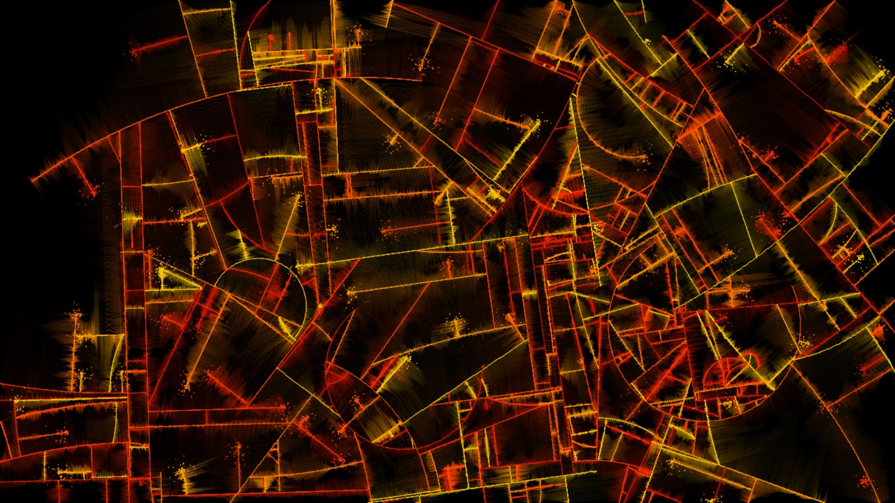
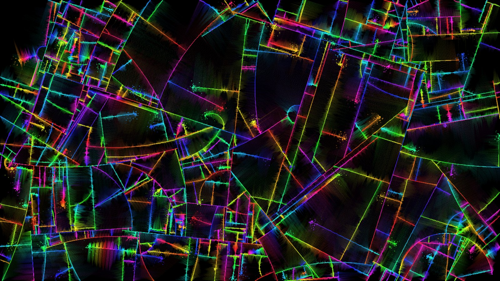
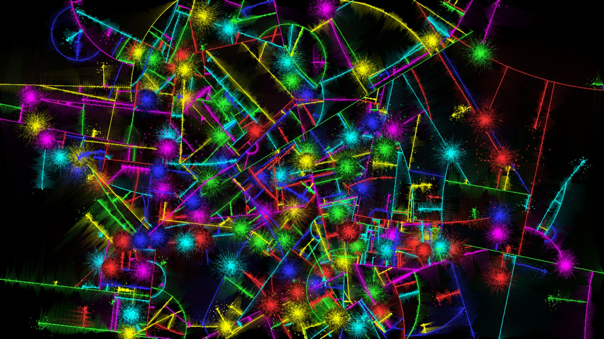
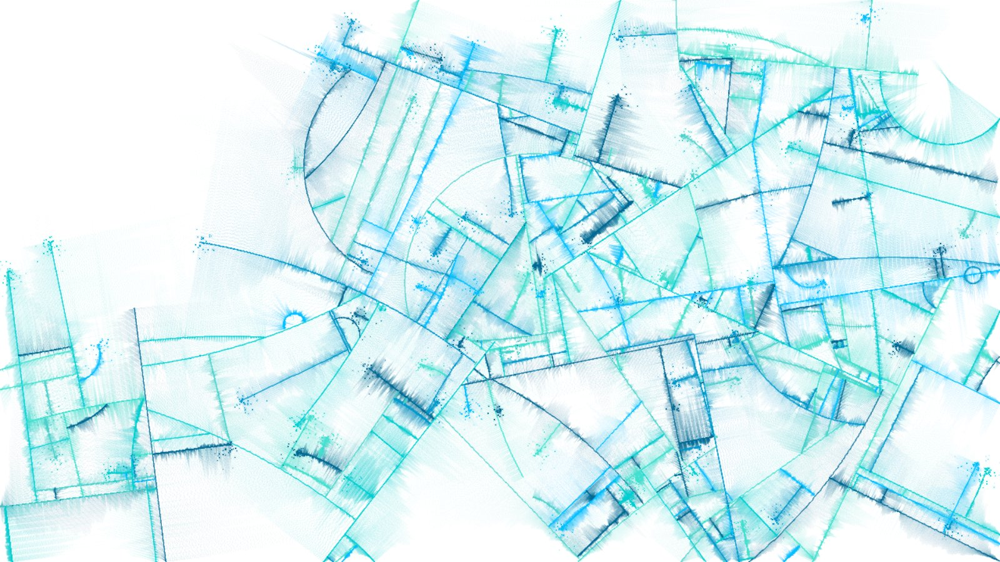
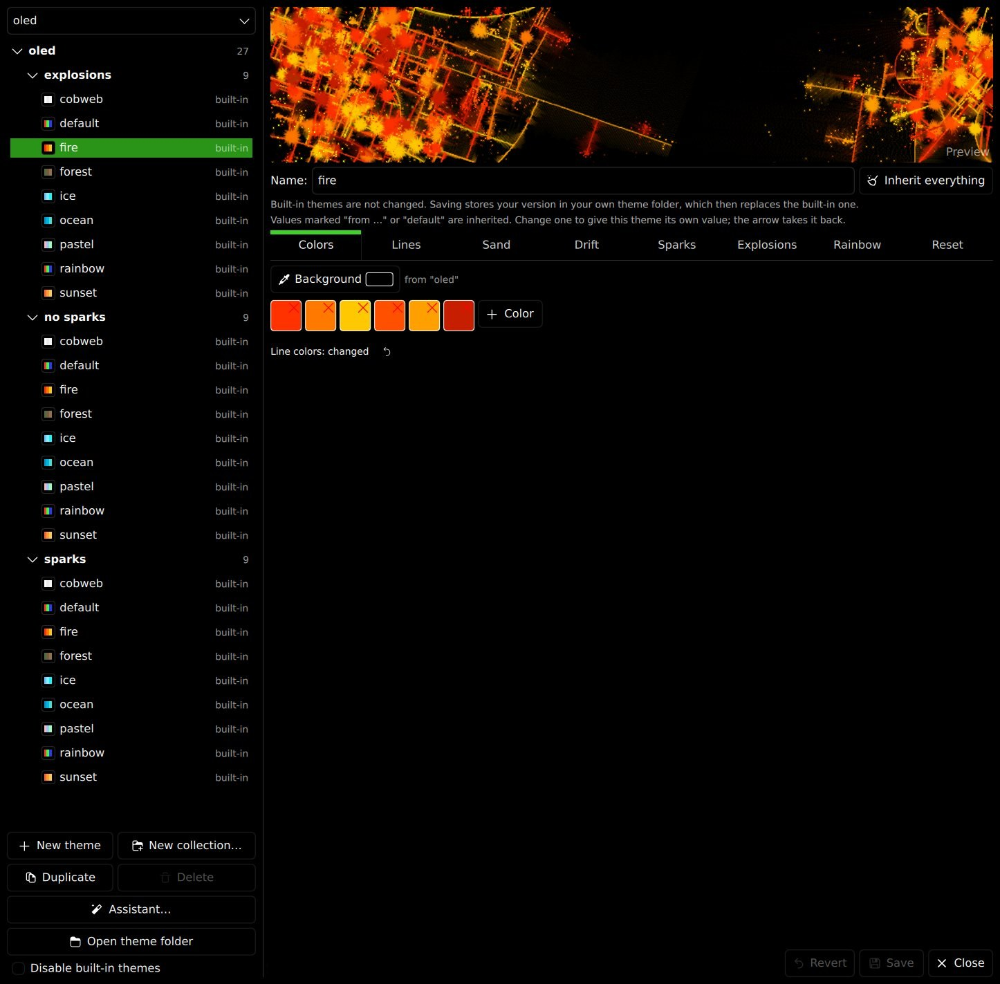
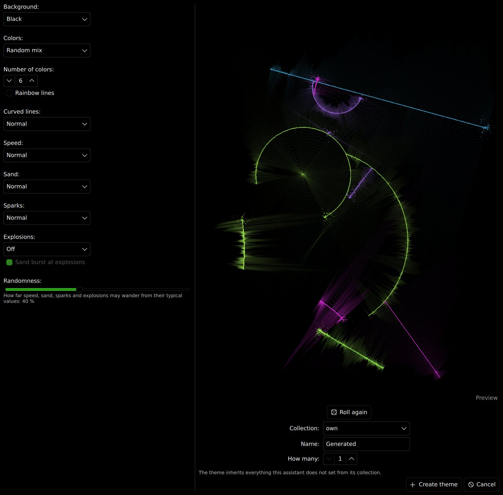

# Substrate for KDE Plasma

A native **Plasma 6 wallpaper** that grows cracks across your desktop: lines race over the screen, branch off
each other at right angles, leave clouds of sand behind them and throw sparks. It is a port of the Substrate
screensaver, written in C++ and Qt Quick. **No browser, no WebEngine and no extra wallpaper plugin is needed.**

| | |
|---|---|
|  |  |
|  |  |

## Features

- **Fast.** The simulation takes about 0.4 ms per step at 1080p (measured with the bundled benchmark), drawing is
  one texture plus a few thousand GPU triangles for the sparks. Smooth at the refresh rate of your screen.
- **Themes in collections.** 54 built-in themes in `bright` and `oled`, each in the variants *no sparks*,
  *sparks* and *explosions*, plus colors that follow your Plasma accent color.
- **Rainbow lines** whose colors fade while they grow, and **explosions**: a line that hits another one can blow
  up, erase everything around the impact and burst into sand and sparks.
- **A theme manager with inheritance.** Collections (also nested) hold default values, themes only store what they
  change. Live preview, drag and drop, context menus, duplicate, delete, reset.
- **A theme assistant.** Answer a few questions (background, palette, ...), let the rest be rolled, and create one
  or many themes at once.
- **Power aware.** Limit the frame rate or pause on battery, while the screen is locked, or while a maximized or
  fullscreen window covers the desktop.
- **Several themes at once.** Tick whole collections and single themes; they take turns.

## Requirements

- KDE Plasma 6 (the plugin is a `Plasma/Wallpaper` package, API 6.0)
- Qt 6.5 or newer with Quick, Qml, Gui and DBus
- To build: CMake 3.21+ and a C++17 compiler

Packages that provide the Qt development files:

| Distribution | Packages |
|---|---|
| Debian / Ubuntu / KDE neon | `cmake g++ qt6-base-dev qt6-declarative-dev libgl-dev libvulkan-dev` |
| Arch / Manjaro | `cmake qt6-base qt6-declarative` |
| Fedora | `cmake gcc-c++ qt6-qtbase-devel qt6-qtdeclarative-devel` |
| openSUSE | `cmake gcc-c++ qt6-base-devel qt6-declarative-devel` |

## Installation

```bash
git clone https://github.com/Spider19996/Substrate-KDE-Wallpaper.git
cd Substrate-KDE-Wallpaper
./install.sh          # builds and installs the wallpaper for your user, no root needed
./install.sh -y       # the same without questions, and restarts Plasma at the end
```

Then right-click the desktop → **Configure Desktop and Wallpaper** → **Wallpaper Type** → **Substrate**.

Plasma only loads a new version of the plugin after a restart:

```bash
systemctl --user restart plasma-plasmashell
```

The build takes about a minute. Everything ends up in one folder,
`~/.local/share/plasma/wallpapers/com.github.spider19996.substrate/`: the wallpaper package including its own plugin
(`contents/ui/lib/libsubstrate.so`). Nothing is installed system-wide. If you prefer to do the steps yourself:
`cmake -S . -B build`, `cmake --build build` (this puts the plugin into `contents/ui/lib`), then copy
`metadata.json` and `contents/` to that folder.

**Ready-made package:** every [GitHub release](https://github.com/Spider19996/Substrate-KDE-Wallpaper/releases) also has
`Substrate-<version>-linux-x86_64.zip`, a finished wallpaper package with its plugin inside. It needs Plasma 6, Qt 6.5
or newer and an x86_64 system. Install it with

```bash
kpackagetool6 -t Plasma/Wallpaper -i Substrate-<version>-linux-x86_64.zip
systemctl --user restart plasma-plasmashell
```

If it does not load on your system, build from source with `./install.sh`. A plugin only loads with the Qt version it
was built against or a newer one, so on a system with an older Qt Plasma reports an "incompatible Qt library"; the
source install is the answer there.

To make the package yourself run `./tools/make-package.sh` (built on your machine, so it needs your Qt version or a
newer one). It ends up in `dist/`.

To remove it again run `./uninstall.sh`. Your own themes in `~/.local/share/substrate-wallpaper` are kept.

## Using it

Right-click the desktop → **Configure Desktop and Wallpaper**. There are three tabs.

**Themes**

- Choose what runs. Tick whole collections (with everything below them) and single themes; they take turns.
  Nothing ticked runs all themes.
- **Manage themes…** opens the theme manager (see below).
- **Disable built-in themes** hides everything that ships with Substrate. Your own themes stay.

**Performance**

- **Animation speed**: simulation steps per second (the `TARGET_FPS` of the original).
- **Maximum frame rate**: upper limit for drawn frames, "Screen refresh rate" means no limit. Themes without
  sparks only draw when a new simulation step is due anyway.
- **Resolution**: 10 – 200 % of the screen size the picture is calculated at.
- **Show frame rate and resource use**: a small overlay with the rendered frames per second, the CPU time of the
  simulation, the memory for the picture and the data sent to the GPU per second.

**Power**

- **On battery**: keep running, limit the frame rate (30 FPS by default) or pause.
- **Pause while** the screen is locked, or while a maximized or fullscreen window covers the desktop.

The desktop context menu also has **Next Substrate Theme** and **Restart Substrate Pattern**; both fade the
current picture out first, like a full one.

### When does the theme change?

When the lines cover a share of the screen (`COVERAGE_RESET_PERCENT`, 10 % by default) the picture fades out and
starts again (a soft reset). After every `HARD_RESET_EVERY`-th soft reset (3 by default) comes a hard reset: fade
out, clear, fade in. Only then another theme of your selection is picked at random. Every screen changes on its
own. Explosions do not keep a picture from filling up: erased pixels still count as drawn.

## Theme manager

Open it with **Manage themes…** in the settings. A popup above the list chooses which collection is shown.



### Inheritance

- Click a **collection** to edit its **defaults**. They apply to every theme in it and in all its subcollections.
- A **theme** only stores the values it changes, everything else is inherited. Next to every value the editor says
  where it comes from (`from "oled"`, `default`, `changed`). The arrow next to a value takes an own value back,
  **Inherit everything** removes all own values of a theme.
- **Subcollections** inherit from their parent and can override it in turn:
  engine defaults → `a` → `a/b` → `a/b/c` → theme. Change the parent and everything below follows.
- Create one with **New collection…** (tick *Inside …*) or from the context menu of the parent.
- **Moving and duplicating** keeps the look: only what differs from the defaults of the target collection becomes
  an own value of the theme.

The built-in collections are built the same way: `bright` and `oled` bring their own defaults and each has the
subcollections **no sparks**, **sparks** and **explosions** that only differ in their defaults. The color themes
inside (cobweb, default, fire, forest, ice, ocean, pastel, rainbow, sunset) inherit that.

Built-in themes are never changed. Saving one (or the defaults of a built-in collection) stores your version in
your theme folder, which then replaces the original ("modified"). *Reset* or *Clear defaults* brings it back.
Built-in collections take no new themes, new ones go into your own collections ("own" by default).

The **system** collection has three themes in the colors of your Plasma accent color (*Accent* on the background
of your color scheme, *Accent black* and *Accent white*). They follow the color scheme and cannot be saved.

### Assistant

**Assistant…** asks for the basics: background (black, white, a dark or light tone, your own color), a palette
(random, neighbouring hues, complementary, triad, one hue with many shades, warm, cool, pastel, neon, around your
Plasma accent color) and the number of colors, rainbow lines, curved lines, speed, sand, sparks and explosions.
Anything set to *Random* is rolled, and the **Randomness** slider says how far the numbers may wander from their
typical values. A live preview shows the current roll. Create one theme, or many at once.



### Other things

- Drag a theme onto a collection to move it (built-in themes are copied).
- Right-click for duplicate, delete, new subcollection, open folder and more.
- **Open theme folder** shows the folder in your file manager; files you drop there are picked up immediately.

## Theme files

Themes live in `~/.local/share/substrate-wallpaper/themes`. Every folder is a collection, nested as deep as you
like:

```
themes/
  mine/
    _collection.json      <- defaults of the collection (optional)
    fast.json             <- a theme, only the values that differ
    blue/
      _collection.json    <- defaults of the subcollection (inherits from "mine")
      deep.json
```

A theme file or `_collection.json` holds a part of the `CONFIG` object of the original HTML version, as JSON:

```json
{
    "BG_COLOR": [0, 0, 0],
    "COLORS": [[255, 50, 0], [255, 120, 0]],
    "STEP_MAX": 1.5,
    "SPARKLER_ENABLED": true
}
```

Missing values come from the collections above, in the end from the engine defaults. Complete theme files, also the
original `.js` files of the HTML version, keep working.

### Settings reference

**Lines**

| Key | Setting | Default | Range |
|---|---|---|---|
| `STEP_MIN` | Minimum speed (px/step) | 0.1 | 0.01 – 10 |
| `STEP_MAX` | Maximum speed (px/step) | 1.5 | 0.01 – 10 |
| `CRACKS_PER_100K_PIXELS` | Start cracks per 100k pixels | 1 | 0 – 20 |
| `MIN_INITIAL_CRACKS` | Minimum start cracks | 2 | 1 – 500 |
| `MAX_INITIAL_CRACKS` | Maximum start cracks | 20 | 1 – 500 |
| `MAX_CRACKS` | Maximum simultaneous cracks | 100 | 1 – 2000 |
| `CIRCLE_PERCENT` | Curved cracks (%) | 40 | 0 – 100 |
| `BRANCH_MODE` | Branching | perpendicular | perpendicular, opposite, random |
| `LINE_WIDTH` | Line width (px) | 1 | 0.1 – 10 |
| `ANTI_ALIASING` | Anti-aliasing | true | on / off |

**Sand**

| Key | Setting | Default | Range |
|---|---|---|---|
| `SAND_MODE` | Sand | both | both, one, none |
| `GRAINS` | Grains per region | 64 | 0 – 512 |
| `SAND_ALPHA` | Sand opacity | 0.1 | 0 – 1 |

**Drift**

| Key | Setting | Default | Range |
|---|---|---|---|
| `LINE_DRIFT_ENABLED` | Straight lines drift | false | on / off |
| `LINE_DRIFT_AMOUNT` | Drift per event (°) | 2 | 0 – 45 |
| `LINE_DRIFT_FREQUENCY` | Drift probability per step | 0.3 | 0 – 1 |

**Sparks**

| Key | Setting | Default | Range |
|---|---|---|---|
| `SPARKLER_ENABLED` | Sparks | true | on / off |
| `SPARK_SPAWN_RATE` | Sparks per crack and step | 3 | 0 – 20 |
| `SPARK_SPEED_MIN` | Minimum spark speed | 0.5 | 0 – 20 |
| `SPARK_SPEED_MAX` | Maximum spark speed | 2.5 | 0 – 20 |
| `SPARK_LIFETIME` | Lifetime (steps) | 15 | 1 – 300 |
| `SPARK_SIZE` | Size (px) | 1.3 | 0.1 – 20 |
| `SPARK_GLOW` | Glow radius (px, 0 = off) | 2 | 0 – 50 |

**Explosions**

| Key | Setting | Default | Range |
|---|---|---|---|
| `EXPLOSIONS` | Lines can explode on impact | false | on / off |
| `EXPLOSION_CHANCE` | Chance per impact (%) | 10 | 0 – 100 |
| `EXPLOSION_RADIUS` | Blast radius (% of the shorter screen side) | 4 | 0.5 – 50 |
| `EXPLOSION_SPARKS` | Sparks per explosion | 60 | 0 – 500 |
| `EXPLOSION_SAND` | Sand burst at the impact | false | on / off |
| `EXPLOSION_SAND_GRAINS` | Grains of the sand burst | 3000 | 0 – 20000 |

**Rainbow**

| Key | Setting | Default | Range |
|---|---|---|---|
| `RAINBOW` | Rainbow lines | false | on / off |
| `RAINBOW_SPEED` | Color change (° of hue per step) | 0.6 | 0.01 – 20 |
| `RAINBOW_SATURATION` | Saturation | 1 | 0 – 1 |
| `RAINBOW_LIGHTNESS` | Lightness (lower on bright backgrounds) | 0.55 | 0.05 – 0.95 |

**Reset**

| Key | Setting | Default | Range |
|---|---|---|---|
| `COVERAGE_RESET_PERCENT` | Reset at coverage (%) | 10 | 1 – 100 |
| `FADE_OUT_SECONDS` | Fade out (s, 0 = instant) | 3 | 0 – 60 |
| `HARD_RESET_EVERY` | Hard reset every n resets (0 = never) | 3 | 0 – 100 |
| `HARD_FADE_SECONDS` | Hard fade out (s) | 2 | 0.1 – 60 |
| `HARD_FADE_IN_SECONDS` | Fade in after hard reset (s) | 2 | 0 – 60 |

**Colors**

| Key | Setting | Default | Range |
|---|---|---|---|
| `BG_COLOR` | Background color `[r, g, b]` | `[0, 0, 0]` | 0 – 255 each |
| `COLORS` | Line colors, a list of `[r, g, b]` | six bright colors | at least one |

Settings of a theme are the keys above; any key can be used in a theme or in a collection's defaults.

**Rainbow, explosions and the rest**

| Key | Meaning |
|---|---|
| `RAINBOW`, `RAINBOW_SPEED`, `RAINBOW_SATURATION`, `RAINBOW_LIGHTNESS` | Lines (and their sand and sparks) run through all hues |
| `EXPLOSIONS`, `EXPLOSION_CHANCE`, `EXPLOSION_RADIUS`, `EXPLOSION_SPARKS` | A line that hits another can explode |
| `EXPLOSION_SAND`, `EXPLOSION_SAND_GRAINS` | A sand burst at the impact |

## Where things are stored

| What | Where |
|---|---|
| Wallpaper settings (selection, frame rate, ...) | `~/.config/plasma-org.kde.plasma.desktop-appletsrc`, section `[Containments][<n>][Wallpaper][com.github.spider19996.substrate][General]`, per screen |
| Your themes | `~/.local/share/substrate-wallpaper/themes/` |
| Small UI state (folded collections, "disable built-in themes") | `~/.local/share/substrate-wallpaper/settings.ini` |
| Built-in themes | inside the wallpaper package, `contents/themes/` |
| The plugin (C++ part) | inside the wallpaper package, `contents/ui/lib/libsubstrate.so` |

## Development

| Path | Purpose |
|---|---|
| `src/substrateengine.*` | The simulation (cracks, sand, sparks, explosions), free of any Qt Quick code |
| `src/substrateitem.*` | The `Substrate` QML element: a texture for the lines and sand, GPU geometry for the sparks |
| `src/themestore.*` | Reads and writes themes and collections, resolves inheritance |
| `src/powermonitor.*` | Battery and screen lock state over D-Bus |
| `contents/ui/` | Wallpaper, settings page, theme manager, assistant |
| `contents/themes/` | The built-in themes |
| `po/` | Translations (German, French, Spanish, Italian, Brazilian Portuguese, Russian, Chinese, Japanese) |
| `tests/bench.cpp` | Headless benchmark of the simulation |

```bash
cmake -S . -B build -DCMAKE_BUILD_TYPE=Release -DSUBSTRATE_BUILD_BENCH=ON
cmake --build build
QT_QPA_PLATFORM=offscreen build/substrate-bench 1920 1080 600 bench.png
```

Set `SUBSTRATE_DEBUG=1` in the environment of the process to get frame timing statistics on stderr every
five seconds. A build copies the plugin into `contents/ui/lib` (not tracked by Git), so the QML files in the source
tree already find it; the wallpaper package is just a copy of `metadata.json` and `contents/`.

See [CONTRIBUTING.md](CONTRIBUTING.md) if you want to help.

## Troubleshooting

- **Plasma still shows the old version after an update:** restart it,
  `systemctl --user restart plasma-plasmashell`. A loaded plugin is not replaced while Plasma runs.
- **"Substrate" is missing in the wallpaper list:** restart Plasma once.
- **The settings or the wallpaper show errors about a missing module or plugin:** the plugin was built against a
  different Qt than the one Plasma runs. Build again with `./install.sh` on the machine you use it on.
- **Choppy motion:** lower the **Resolution** or the **Maximum frame rate**, or pick a theme without sparks.

## Credits

Substrate was created by **Jared Tarbell**. This project is based on the HTML port
[Spider19996/HTML-Substrate-Wallpaper](https://github.com/Spider19996/HTML-Substrate-Wallpaper).

## License

MIT, see [LICENSE](LICENSE).
